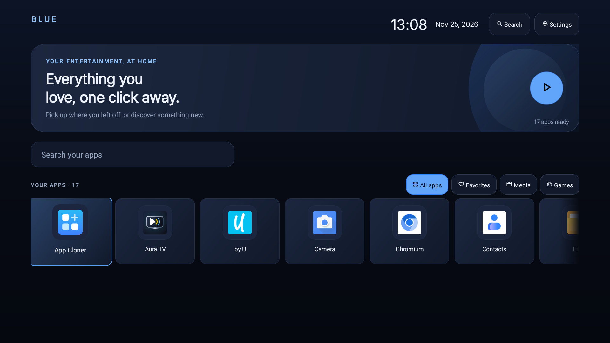
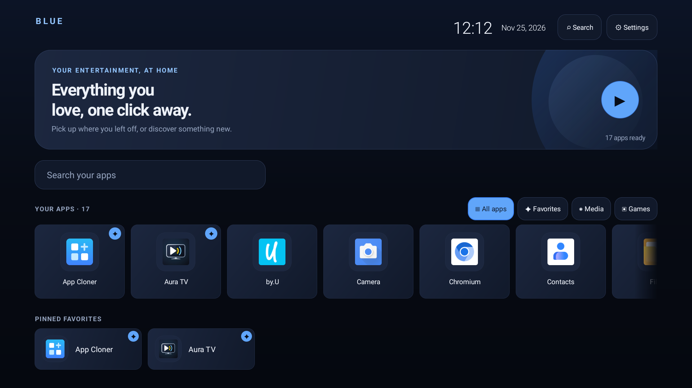
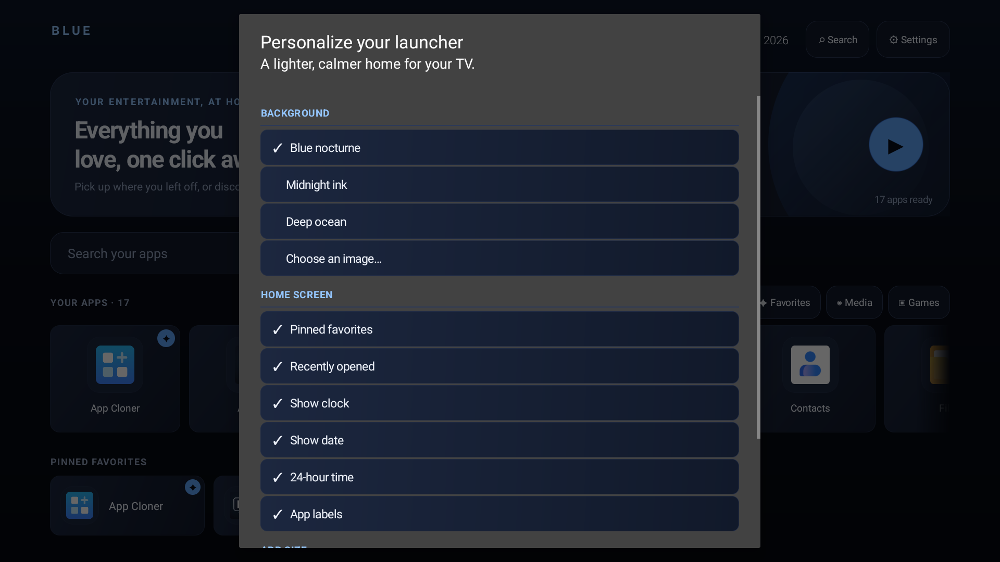

<p align="center">
  
</p>

# BlueLauncher

[](https://github.com/vryptt-ctrl/BlueLauncher/actions/workflows/ci.yml)
[](https://github.com/vryptt-ctrl/BlueLauncher/releases)
[](LICENSE)
[](https://developer.android.com/tv)

Home launcher for Android TV. Kotlin handles the Android lifecycle, package discovery, D-pad UI and preferences. A small Rust library, called over JNI, handles app search and ranking.

No network access, analytics, ads, database, Compose, Leanback, RecyclerView or background services. The UI is plain platform Views built in code.

| Home | Search |
| --- | --- |
|  |  |
| **Favorites & recents** | **Settings** |
|  |  |

## Overview

- Registers `LEANBACK_LAUNCHER` and `HOME`, so it shows up in the Android TV Home-app chooser.
- Lists TV and regular launcher apps via scoped package visibility. Install/update broadcasts are debounced into a single refresh while the home screen is visible, with a rescan on resume as a fallback.
- Favorites with manual ordering, bounded recents, category filters.
- Search ranked in Rust; falls back to Kotlin if the native library can't be loaded.
- Three dark themes, custom image wallpaper, adjustable card size and labels, clock/date following the system time format.
- Package and wallpaper work runs off the main thread. Animations are short focus scale/glow only; nothing runs continuously.

Size and startup, measured on modest hardware: internal UI ready in about 160 ms, debug APK about 3.9 MB (three ABIs), release APK under 1.2 MB after R8.

## Install

1. Download the latest `.apk` from the [Releases page](https://github.com/vryptt-ctrl/BlueLauncher/releases).
2. Get the file onto your TV. Any of these works:
   - Download it on a PC or phone, copy it to a USB drive and plug it into the TV.
   - Open the Releases page in a browser or downloader app on the TV and download it there.
   - Send it from your phone with a file-transfer app that supports Android TV.
3. Open the APK with a file manager on the TV and install it. If the TV blocks the install, allow installs from unknown sources for that app when prompted. The setting is usually under Settings > Device Preferences > Security & restrictions, though the path varies by device.
4. Press the Home button and choose **BlueLauncher** in the Home-app chooser. Pick "Always" if your TV offers it to keep it as the default.

## Build

Requirements:

- JDK 17
- Android SDK Platform 36 and Build Tools
- Android NDK `27.2.12479018`
- Rust with the Android targets, and `cargo` on `PATH`

```sh
rustup target add aarch64-linux-android armv7-linux-androideabi x86_64-linux-android
```

Gradle runs Cargo for each ABI and packages the `cdylib` outputs. If the NDK isn't at `$ANDROID_HOME/ndk/27.2.12479018`, set `ANDROID_NDK_HOME`.

```sh
# macOS / Linux
export ANDROID_NDK_HOME="$ANDROID_HOME/ndk/27.2.12479018"
./gradlew assembleDebug testDebugUnitTest lintDebug
```

```powershell
# Windows
$env:ANDROID_NDK_HOME = "$env:ANDROID_HOME/ndk/27.2.12479018"
.\gradlew.bat assembleDebug testDebugUnitTest lintDebug
```

Output: `app/build/outputs/apk/debug/app-debug.apk`.

`assembleRelease` runs R8 and resource shrinking and produces an unsigned APK. Add your own signing config before distributing. The APKs on the releases page are signed by the maintainer; the key is not in this repo.

ARM64 and x86_64 libraries are linked with 16 KB page alignment for Android 15+. 32-bit ARM stays at 4 KB.

## Tests

JVM unit tests cover the preference, category and label-splitting logic (`LauncherPreferences.mergeOrder`, `moveFavoriteIn`, recents bounding, category filters, `TvUi.glyphRuns`). No Robolectric needed.

Native scorer tests:

```sh
cargo test --manifest-path app/src/main/rust/Cargo.toml
```

## Compatibility

- `minSdk 23`.
- Native ranking is packaged for `arm64-v8a`, `armeabi-v7a` and `x86_64`. Gradle currently emits only those three ABIs.
- On Android 11+ only apps matched by the declared launcher intent queries are visible. This is intentional.
- Wallpapers come from the system document picker, are copied into app-private storage and downsampled to 1920x1080. No storage permission is requested.

## Contributing

Read [CONTRIBUTING.md](CONTRIBUTING.md) first. Use the [issue templates](.github/ISSUE_TEMPLATE) for bugs and feature requests, and the [PR template](.github/PULL_REQUEST_TEMPLATE.md) for pull requests.

Security issues: see [SECURITY.md](SECURITY.md).

## License

[GPL-3.0](LICENSE)