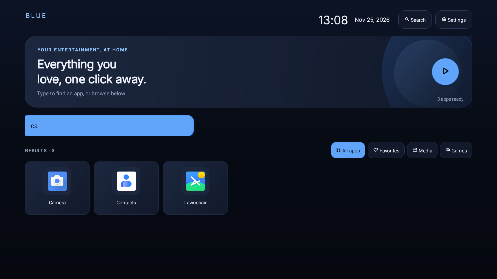

# BlueLauncher

[](https://github.com/vryptt-ctrl/BlueLauncher/actions/workflows/ci.yml)
[](LICENSE)
[](https://github.com/vryptt-ctrl/BlueLauncher/releases)
[](https://developer.android.com/tv)

<p align="center">
  
</p>

A deliberately small, native Android TV home launcher: Kotlin owns the Android lifecycle, package discovery, D-pad UI and preferences; a compact Rust/JNI module ranks and searches apps. There are no network calls, analytics, ads, database, Compose runtime, periodic services or large UI framework.

## Highlights

- **Fast**: programmatic platform Views, no Compose/RecyclerView/Leanback; internal UI ready in ~160 ms on modest hardware.
- **Light**: ~3.9 MB debug APK with three ABIs; release builds are R8-shrunk below 1 MB (unsigned).
- **Native core**: Rust ranking/search via JNI, with an automatic Kotlin fallback.
- **TV-first**: full D-pad navigation, focus lift + glow, spotlight pills, poster-style app cards.
- **Personal**: ordered favorites, bounded recents with one-click resume, category filters, three dark themes, custom image wallpaper, clock/date options.

## Screenshots

| Home | Search |
| --- | --- |
|  |  |
| **Favorites & recents** | **Settings** |
|  |  |

## Features

- Registers both `LEANBACK_LAUNCHER` and `HOME` intents. Select **BlueLauncher** in Android TV's Home-app chooser to make it the default.
- Discovers TV-launchable and regular launcher apps using scoped Android package visibility. A lightweight receiver coalesces install/update broadcasts into a debounced refresh while the home screen is visible, and a scan runs on the next resume as a fallback.
- Launches TV app activities, shows recently opened apps, pins favorites, and supports app/favorite ordering.
- Searches apps using a Rust JNI scorer, with a Kotlin fallback for unsupported devices and ABIs.
- Offers app categories, adjustable app card size and labels, system-time-format clock/date, three color themes, and imported custom image wallpaper.
- Uses platform Views, off-main-thread package and wallpaper work, bounded launch history, focus indicators, short scale animations and no continuously running animator.

## Requirements

- Android Studio with JDK 17
- Android SDK Platform 36 and Build Tools
- Android NDK `27.2.12479018`
- Rust toolchain with `aarch64-linux-android`, `armv7-linux-androideabi` and `x86_64-linux-android` targets installed
- Windows, macOS or Linux host with Cargo available on `PATH`

The Gradle build runs Cargo for all three ABIs and packages the `cdylib` shared libraries automatically. ARM64 and x86_64 output is linked with 16 KB page alignment for Android 15+ devices; 32-bit ARM keeps its 4 KB layout. Set `ANDROID_NDK_HOME` to your NDK directory when the NDK isn't under `$ANDROID_HOME/ndk/27.2.12479018`.

## Build

```shell
# Windows PowerShell: set the NDK path if Android Studio has a non-default SDK location
$env:ANDROID_NDK_HOME = "$env:ANDROID_HOME/ndk/27.2.12479018"
.\gradlew.bat assembleDebug
.\gradlew.bat testDebugUnitTest
.\gradlew.bat lintDebug
```

```sh
# macOS / Linux
export ANDROID_NDK_HOME="$ANDROID_HOME/ndk/27.2.12479018"
./gradlew assembleDebug testDebugUnitTest lintDebug
```

The debug APK is `app/build/outputs/apk/debug/app-debug.apk` (about 3.9 MB with all three ABIs). `assembleRelease` runs R8 and resource shrinking and produces an unsigned APK; add a private signing config before distributing it. **The project does not contain a production signing key.**

Unit tests cover the pure preference and category logic (`LauncherPreferences.mergeOrder`, `moveWithin`, recent-history bounding and category filters) and run on the JVM without Robolectric. Run native scorer tests with:

```sh
cargo test --manifest-path app/src/main/rust/Cargo.toml
```

## Installing on a device

```sh
adb install -r app/build/outputs/apk/debug/app-debug.apk
```

To make BlueLauncher the home screen on Android TV:

```sh
adb shell cmd package set-home-activity com.bluelabs.bluelauncher/.MainActivity
```

## Architecture

- `app/src/main/kotlin/.../MainActivity.kt` — one immersive home Activity, lifecycle, receiver and worker executor.
- `data/AppRepository.kt` — scoped launcher/Leanback app queries and launch intents.
- `data/LauncherPreferences.kt` — small SharedPreferences model: favorites, manual order, recents and display options.
- `data/WallpaperStore.kt` — image picker imports downsampled RGB_565 backgrounds on a worker thread.
- `ui/LauncherViews.kt` — D-pad-first platform Views and rendering.
- `ui/TvUi.kt`, `ui/Palette.kt` — focus drawables, lift/glow animations and color roles for the three themes.
- `nativeengine/NativeEngine.kt` / `app/src/main/rust` — JNI search ranking and preference scoring.
- `proguard-rules.pro` — keeps the JNI entry points alive through R8.

The only AndroidX artifact is `androidx.activity`, used for lifecycle-safe document-picker results and predictive-back handling. Dialogs use the platform `AlertDialog`; all home UI is programmatic platform Views.

## Branding

The Focus Grid brand assets — logo, icon set, TV banner and social preview — live in [`brand/`](brand/README.md), including editable SVG sources, and are licensed under [CC BY 4.0](brand/LICENSE-ASSETS.md) (the code is GPL-3.0; the licenses are independent). The logo is original artwork.

## Contributing

See [CONTRIBUTING.md](CONTRIBUTING.md). Bug reports and feature requests are welcome through [issue templates](.github/ISSUE_TEMPLATE); pull requests should follow the [PR template](.github/PULL_REQUEST_TEMPLATE.md).

## Security

See [SECURITY.md](SECURITY.md). BlueLauncher is offline by design: no network permissions, no analytics, no background services.

## Compatibility notes

`minSdk 23` supports older TV hardware. ARM64, ARMv7 and x86_64 builds include native ranking; other ABIs use the Kotlin fallback, but the current Gradle packaging list only emits those three common ABIs. Android 11+ intentionally only exposes apps declared through launcher intent queries. A wallpaper is selected with Android's system document picker, imported into app-private storage, and downsampled to 1920x1080; no broad storage permission is required. Replace the inherited root `LICENSE` before publishing if the BlueLauncher source is not intended to be distributed under GPL-3.0.
